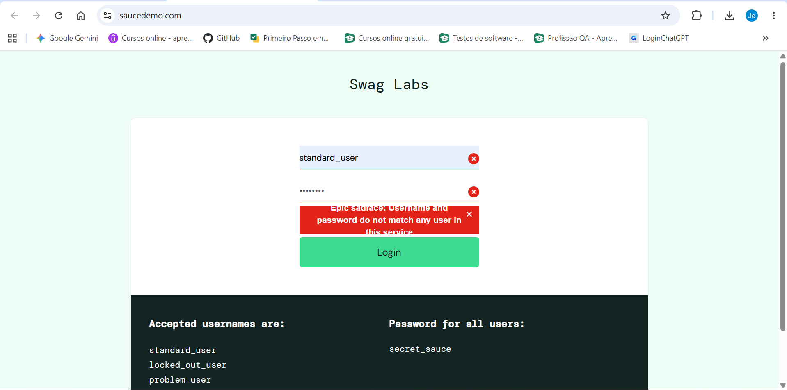

# CT-002 — Login com usuário válido e senha incorreta

## Identificação
- **ID:** CT-002
- **Funcionalidade:** Login
- **Sistema:** SauceDemo
- **Tipo de teste:** Funcional
- **Status registrado:** PASSED

## Objetivo
Verificar se o sistema impede o acesso quando são informados usuário válido e senha incorreta.

## Pré-condições
- O sistema SauceDemo deve estar acessível.
- O usuário deve estar na página de login.
- Não deve existir uma sessão autenticada.

## Dados de teste
- **Usuário:** standard_user
- **Senha:** 12345

## Passos para execução
1. Acessar a página de login do SauceDemo.
2. Preencher os campos Username e Password com os dados definidos na seção Dados de Teste.
3. Clicar no botão **Login**.

## Resultado esperado
O sistema deve impedir a autenticação e apresentar uma mensagem informando que as credenciais são inválidas.

## Resultado obtido
O sistema impediu o acesso e apresentou a mensagem:
`Epic sadface: Username and password do not match any user in this service`

## Status
**PASSED**

## Justificativa
O teste foi considerado aprovado porque o sistema impediu o acesso com as credenciais inválidas.

## Evidência da execução

