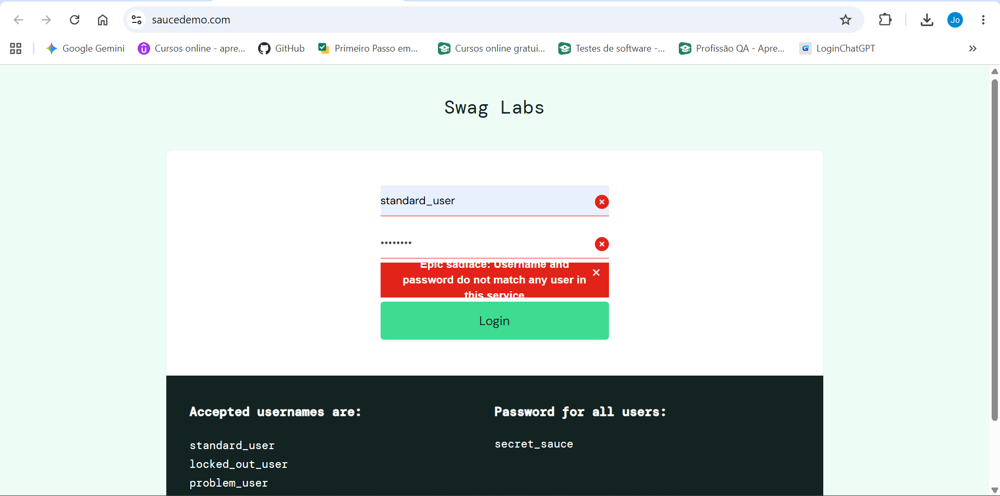

# CT-002 — Login com credenciais inválidas

## Identificação
- **ID:** CT-002
- **Funcionalidade:** Login
- **Sistema:** SauceDemo
- **Tipo de teste:** Funcional
- **Status registrado:** PASSED

## Objetivo
Verificar se o sistema impede o acesso quando são informadas credenciais inválidas.

## Pré-condições
- O sistema SauceDemo deve estar acessível.
- O usuário deve estar na página de login.
- Não deve existir uma sessão autenticada.

## Dados de teste
- **Usuário:** standard_user
- **Senha:** 12345

> Observação: os valores exatos das credenciais não foram recuperados no registro disponível. Preencha-os conforme a execução original, se desejar manter essa informação no documento.

## Passos para execução
1. Acessar a página de login do SauceDemo.
2. Informar credenciais inválidas.
3. Clicar no botão **Login**.
4. Observar a resposta apresentada pelo sistema.

## Resultado esperado
O sistema deve impedir a autenticação e apresentar uma mensagem informando que as credenciais são inválidas.

## Resultado obtido
Conforme o registro original, a senha informada estava incorreta e o acesso não foi realizado.

## Status
**PASSED**

## Justificativa
O teste foi considerado aprovado porque o sistema impediu o acesso com as credenciais inválidas.

## Evidência da execução

