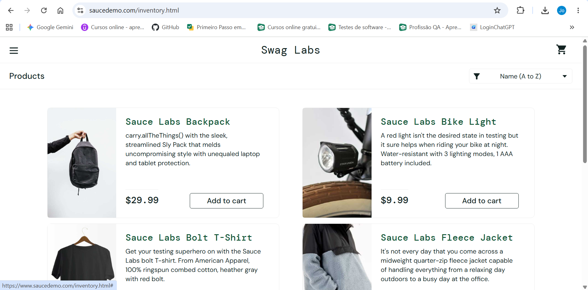

# CT-003 — Login com credenciais válidas

## Identificação

- **ID:** CT-003
- **Funcionalidade:** Login
- **Sistema:** SauceDemo
- **Tipo de teste:** Funcional — cenário positivo

## Objetivo

Verificar se o sistema permite a autenticação quando são informadas credenciais válidas e direciona o usuário à página de produtos.

## Pré-condições

- O sistema SauceDemo deve estar acessível.
- O usuário deve estar na página de login.
- Não deve existir uma sessão autenticada.

## Dados de teste

- **Username:** `standard_user`
- **Password:** `secret_sauce`

## Passos para execução

1. Acessar a página de login do SauceDemo.
2. Preencher o campo Username com `standard_user`.
3. Preencher o campo Password com `secret_sauce`.
4. Clicar no botão **Login**.
5. Verificar se o sistema realiza a autenticação e direciona o usuário à página de produtos.

## Resultado esperado

O sistema deve autenticar o usuário com sucesso e direcioná-lo à página de produtos, exibindo a listagem de produtos sem apresentar mensagens de erro.

## Resultado obtido

O sistema realizou a autenticação e redirecionou o usuário para a página de produtos do SauceDemo, onde foi possível visualizar a lista de produtos, sem exibição de mensagem de erro.

## Status

**PASSED**

## Justificativa

O teste foi considerado aprovado porque o sistema permitiu o acesso com credenciais válidas e direcionou o usuário à página de produtos, conforme o resultado esperado.

## Evidência da execução

