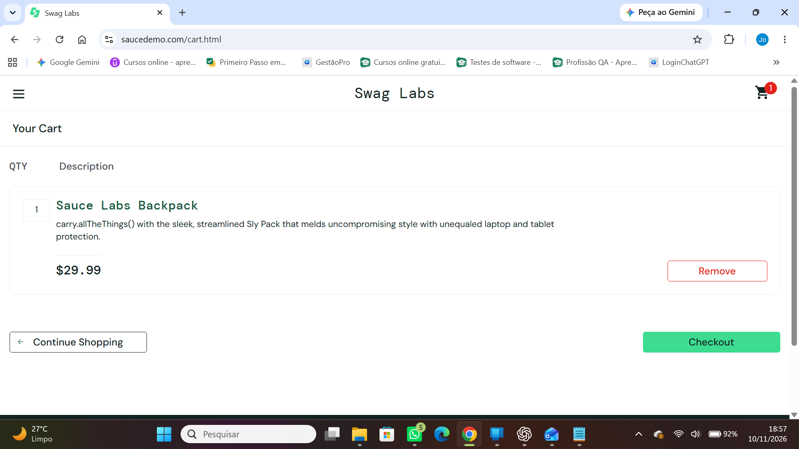

# CT-004 — Adição de produto ao carrinho de compras

**História de usuário:** HU-002 — Gerenciamento de produtos no carrinho de compras  
**Critério de aceitação principal:** CA-01 — Adicionar produto  
**Sistema:** [SauceDemo](https://www.saucedemo.com/)  
**Tipo de teste:** Funcional manual  
**Data de execução:** 10/11/2026  
**Status:** PASSED

## Objetivo

Verificar se o sistema permite que um usuário autenticado adicione corretamente o produto Sauce Labs Backpack ao carrinho de compras.

## Pré-condições

- Usuário autenticado no SauceDemo.
- Carrinho de compras vazio.

## Dados de teste

- **Username:** `standard_user`
- **Password:** `secret_sauce` (credencial pública de demonstração)
- **Produto:** `Sauce Labs Backpack`

## Passos para execução

1. Localizar o produto **Sauce Labs Backpack** na página de produtos.
2. Clicar no botão **Add to cart** do produto.
3. Verificar o contador exibido no ícone do carrinho.
4. Acessar o carrinho de compras.
5. Verificar o nome do produto e a quantidade apresentada no carrinho.

## Resultado esperado

O produto **Sauce Labs Backpack** deve constar no carrinho de compras, com quantidade **1**, e o contador do ícone do carrinho deve exibir **1**.

## Resultado obtido

O sistema apresentou o produto **Sauce Labs Backpack** no carrinho de compras, com quantidade **1**, e o contador do ícone do carrinho exibiu **1**.

## Evidência de execução

> **Observação:** a captura comprova o estado final do carrinho. A execução dos passos e a condição inicial de carrinho vazio foram informadas pela testadora. A remoção do produto será documentada separadamente no CT-005.
