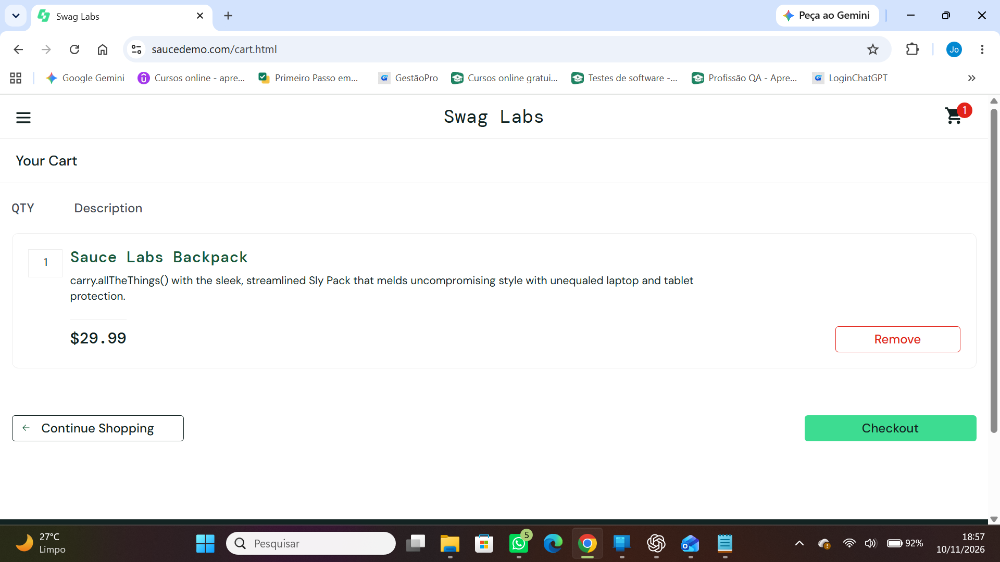

# CT-004 — Adição de produto ao carrinho de compras

## Identificação

- **ID:** CT-004
- **Funcionalidade:** Carrinho de compras
- **Sistema:** SauceDemo
- **Tipo de teste:** Funcional — cenário positivo
- **História de usuário:** [HU-002 — Gerenciamento do carrinho de compras](../../requisitos/HU-002-gerenciamento-carrinho.md)
- **Critério de aceitação:** [CA-01 — Adicionar produto ao carrinho](../../requisitos/HU-002-gerenciamento-carrinho.md#ca-01--adicionar-produto-ao-carrinho)
- **Data da execução:** 10/11/2026

## Objetivo

Verificar se o sistema permite que um usuário autenticado adicione o produto Sauce Labs Backpack ao carrinho de compras, atualizando corretamente a quantidade de itens.

## Pré-condições

- O sistema SauceDemo deve estar acessível.
- O usuário deve estar autenticado.
- O carrinho de compras deve estar vazio.

## Dados de teste

- **Username:** `standard_user`
- **Password:** `secret_sauce`
- **Produto:** `Sauce Labs Backpack`

## Passos para execução

1. Na página de produtos, localizar o produto **Sauce Labs Backpack**.
2. Clicar no botão **Add to cart** correspondente ao produto.
3. Verificar se o contador do ícone do carrinho exibe `1`.
4. Clicar no ícone do carrinho para acessar a página de compras.
5. Verificar se o produto **Sauce Labs Backpack** está listado com quantidade `1`.

## Resultado esperado

O produto Sauce Labs Backpack deve constar no carrinho de compras com quantidade 1, e o contador do ícone do carrinho deve exibir 1.

## Resultado obtido

O sistema apresentou o produto Sauce Labs Backpack no carrinho de compras, com quantidade 1, e o contador do ícone do carrinho exibiu 1.

## Status

**PASSED**

## Justificativa

O teste foi considerado aprovado porque o produto foi adicionado corretamente ao carrinho, com quantidade 1, e o contador foi atualizado conforme o critério de aceitação CA-01.

## Evidência da execução

> **Observação:** A captura comprova o estado final do carrinho. A condição inicial de carrinho vazio e a ação de adicionar o produto foram registradas na execução, mas não aparecem visualmente nessa imagem.

