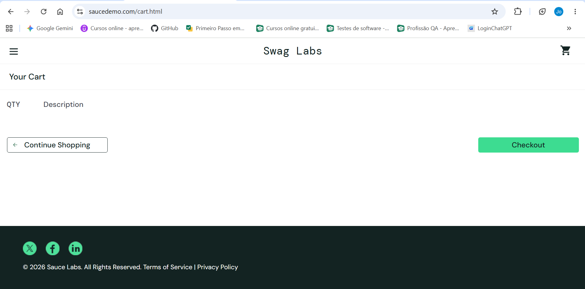

# CT-005 — Remover produto do carrinho de compras

**Sistema:** SauceDemo  
**Funcionalidade:** Carrinho de compras — remoção de produto  
**História de usuário:** HU-002 — Gerenciamento de produtos no carrinho de compras  
**Critério de aceitação:** CA-02 — Remover produto

## Objetivo
Verificar se o sistema permite remover o único produto do carrinho de compras.

## Pré-condições
- O usuário deve estar autenticado no SauceDemo.
- O carrinho de compras deve conter exatamente um produto: Sauce Labs Backpack.

## Dados de teste
- **Usuário:** `standard_user`
- **Senha:** `secret_sauce`
- **Produto utilizado:** Sauce Labs Backpack

## Passos para execução
1. Acessar o carrinho de compras.
2. Clicar em **Remove** no produto adicionado.
3. Verificar se o produto deixou de aparecer no carrinho.
4. Observar e registrar o comportamento do contador do carrinho após a remoção do produto.

## Resultado esperado
O produto Sauce Labs Backpack deve deixar de ser exibido no carrinho de compras após a remoção.

## Resultado obtido
O produto Sauce Labs Backpack foi removido do carrinho de compras. Como era o único produto, o contador deixou de ser exibido na página. Não foi apresentada mensagem de erro.

## Observação de QA
O carrinho continha apenas um produto. Após sua remoção, o contador deixou de ser exibido. A história de usuário e o critério de aceitação não especificam se, quando o último produto é removido, o contador deve ser ocultado ou apresentar o valor zero. Classifiquei como comportamento pendente de esclarecimento.

## Status
**PASSED**

## Justificativa
O sistema removeu o produto e não apresentou erro.

## Evidência da execução

