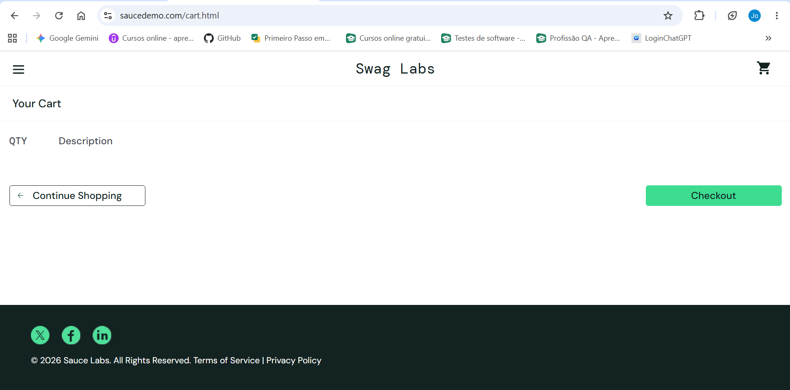

# CT-005 — Remoção do único produto do carrinho

## Identificação

- **ID:** CT-005
- **Funcionalidade:** Carrinho de compras
- **Sistema:** SauceDemo
- **Tipo de teste:** Funcional — cenário positivo
- **História de usuário:** [HU-002 — Gerenciamento do carrinho de compras](../../requisitos/HU-002-gerenciamento-carrinho.md)
- **Critério de aceitação:** [CA-02 — Remover produto do carrinho](../../requisitos/HU-002-gerenciamento-carrinho.md#ca-02--remover-produto-do-carrinho)

## Objetivo

Verificar se o sistema permite remover o único produto existente no carrinho de compras.

## Pré-condições

- O sistema SauceDemo deve estar acessível.
- O usuário deve estar autenticado.
- O carrinho deve conter exatamente um produto: Sauce Labs Backpack.

## Dados de teste

- **Username:** `standard_user`
- **Password:** `secret_sauce`
- **Produto:** `Sauce Labs Backpack`

## Passos para execução

1. Acessar o carrinho de compras.
2. Localizar o produto Sauce Labs Backpack.
3. Clicar no botão **Remove** correspondente ao produto.
4. Verificar se o produto deixou de ser exibido no carrinho.
5. Observar o comportamento do contador do carrinho após a remoção.

## Resultado esperado

O produto Sauce Labs Backpack deve ser removido do carrinho de compras e deixar de aparecer na lista de itens.

## Resultado obtido

O sistema removeu o produto Sauce Labs Backpack do carrinho de compras. Como era o único item, o contador deixou de ser exibido na página. Não foi apresentada mensagem de erro.

## Status

**PASSED**

## Justificativa

O teste foi considerado aprovado porque o sistema removeu corretamente o único produto do carrinho, conforme o resultado esperado.

## Observação de QA

Após a remoção do último item, o contador do carrinho deixou de ser exibido. Como o requisito HU-002 não especifica se o contador deve ser ocultado ou apresentar o número zero, esse comportamento permanece pendente de definição.

## Evidência da execução

