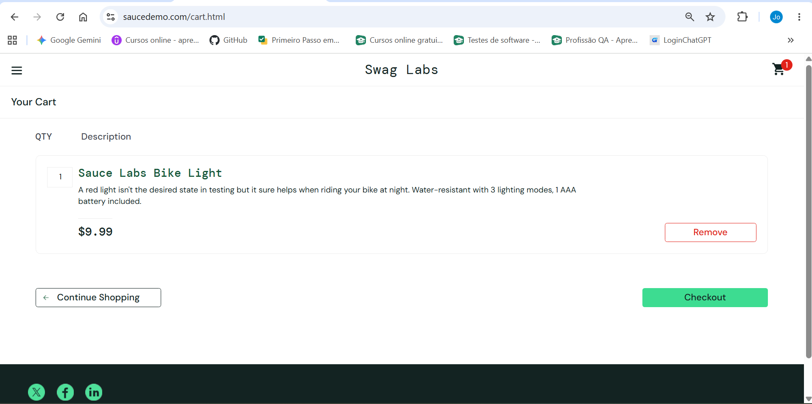

# CT-006 — Remover um produto de um carrinho com dois itens

## Identificação

- **ID:** CT-006
- **Funcionalidade:** Carrinho de compras
- **Sistema:** SauceDemo
- **Tipo de teste:** Funcional — cenário positivo
- **História de usuário:** [HU-002 — Gerenciamento do carrinho de compras](../../requisitos/HU-002-gerenciamento-carrinho.md)
- **Critério de aceitação:** [CA-02 — Remover produto do carrinho](../../requisitos/HU-002-gerenciamento-carrinho.md#ca-02--remover-produto-do-carrinho)

## Objetivo

Verificar se o sistema remove somente o produto selecionado, mantém o outro produto no carrinho e atualiza corretamente o contador de itens de 2 para 1.

## Pré-condições

- O sistema SauceDemo deve estar acessível.
- O usuário deve estar autenticado.
- O carrinho deve conter exatamente dois produtos: Sauce Labs Backpack e Sauce Labs Bike Light.

## Dados de teste

- **Username:** `standard_user`
- **Password:** `secret_sauce`
- **Produto a remover:** `Sauce Labs Backpack`
- **Produto que deve permanecer:** `Sauce Labs Bike Light`
- **Quantidade inicial:** 2 itens

## Passos para execução

1. Acessar o carrinho de compras.
2. Verificar e registrar se o contador indica 2 itens.
3. Localizar o produto Sauce Labs Backpack.
4. Clicar no botão **Remove** correspondente ao produto.
5. Verificar se o produto Sauce Labs Backpack deixou de ser exibido.
6. Verificar se o produto Sauce Labs Bike Light permanece no carrinho.
7. Verificar se o contador indica 1 item.

## Resultado esperado

- O produto Sauce Labs Backpack deve ser removido do carrinho.
- O produto Sauce Labs Bike Light deve permanecer no carrinho.
- O contador deve ser atualizado de 2 para 1.

## Resultado obtido

O produto Sauce Labs Backpack foi removido do carrinho de compras, o produto Sauce Labs Bike Light permaneceu no carrinho e o contador passou a indicar 1 item, conforme observado na execução.

## Status

**PASSED**

## Justificativa

O teste foi considerado aprovado porque o sistema removeu somente o produto selecionado, manteve o outro produto no carrinho e atualizou corretamente o contador de 2 para 1.

## Evidência da execução

> **Observação de QA:** A captura existente comprova o estado final. Para demonstrar visualmente a transição do contador de 2 para 1, recomenda-se incluir também uma captura anterior à remoção.
