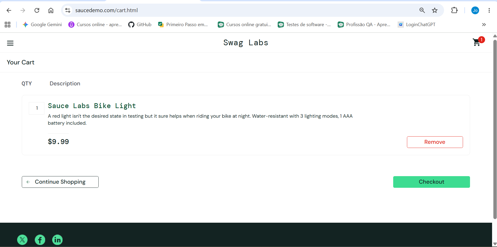

# CT-006 — Remover um produto com dois itens no carrinho de compras

**Sistema:** SauceDemo  
**Funcionalidade:** Carrinho de compras — remoção de produto  
**História de usuário:** HU-002 — Gerenciamento de produtos no carrinho de compras  
**Critério de aceitação:** CA-02 — Remover produto

## Objetivo
Verificar se, ao remover um dos dois produtos do carrinho de compras, o sistema remove apenas o produto selecionado, mantém o outro no carrinho e atualiza o contador de 2 para 1.

## Pré-condições
- O usuário deve estar autenticado no SauceDemo.
- O carrinho de compras deve conter exatamente dois produtos: Sauce Labs Backpack e Sauce Labs Bike Light.

## Dados de teste
- **Usuário:** `standard_user`
- **Senha:** `secret_sauce`
- **Produto a remover:** Sauce Labs Backpack
- **Produto que deve permanecer:** Sauce Labs Bike Light
- **Quantidade inicial de itens:** 2

## Passos para execução
1. Acessar o carrinho de compras.
2. Clicar no botão **Remove** correspondente ao produto **Sauce Labs Backpack**.
3. Verificar se o contador do carrinho passou de **2** para **1**.
4. Verificar se o produto **Sauce Labs Backpack** foi removido e se apenas o produto **Sauce Labs Bike Light** permanece no carrinho.

## Resultado esperado
- O produto **Sauce Labs Backpack** deve deixar de ser exibido no carrinho de compras.
- O produto **Sauce Labs Bike Light** deve continuar sendo exibido no carrinho.
- O contador do carrinho deve indicar **1** item.

## Resultado obtido
O produto **Sauce Labs Backpack** foi removido do carrinho de compras, o produto **Sauce Labs Bike Light** permaneceu no carrinho e o contador passou a indicar **1** item, conforme relatado na execução.

## Status
**PASSED**

## Justificativa
Os três comportamentos verificados corresponderam ao resultado esperado: remoção somente do produto selecionado, permanência do outro produto e atualização do contador de 2 para 1.

## Evidência da execução

