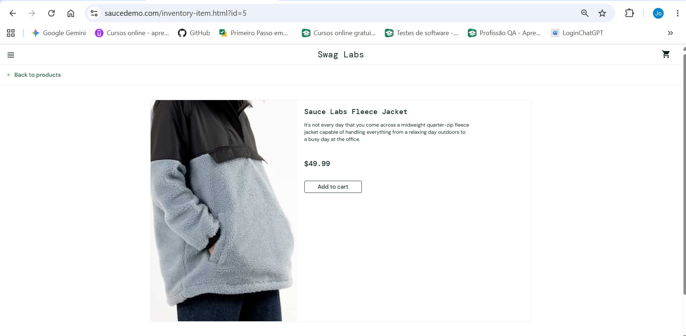

# CT-007 — Visualizar detalhes de um produto

## Identificação

- **ID:** CT-007
- **Sistema:** SauceDemo
- **Funcionalidade:** Catálogo de produtos — visualização dos detalhes de um produto
- **Tipo de teste:** Funcional — cenário positivo
- **Data da execução inicial:** 12/11/2026
- **Data da reexecução:** 18/11/2026

## Objetivo

Verificar se, ao clicar em um produto na listagem, o sistema exibe a página de detalhes com nome, imagem, descrição e preço visíveis.

## Pré-condições

- O usuário deve estar autenticado no SauceDemo.
- O usuário deve estar na página de listagem de produtos.

## Dados de teste

- **Username:** `standard_user`
- **Password:** `secret_sauce` (credencial pública de demonstração)
- **Produto:** `Sauce Labs Fleece Jacket`

## Passos para execução

1. Na listagem de produtos, localizar o produto **Sauce Labs Fleece Jacket**.
2. Registrar o nome, a imagem e o preço apresentados na listagem.
3. Clicar no nome **Sauce Labs Fleece Jacket** para abrir a página de detalhes.
4. Comparar o nome, a imagem e o preço da página de detalhes com os dados registrados na listagem.
5. Verificar se a descrição do produto está sendo exibida na página de detalhes.

## Resultado esperado

A página de detalhes do **Sauce Labs Fleece Jacket** deve ser exibida corretamente.

O nome, a imagem e o preço devem corresponder às informações registradas na listagem de produtos. A descrição do produto também deve estar visível na página de detalhes.

## Resultado obtido

A página de detalhes do produto Sauce Labs Fleece Jacket foi aberta corretamente.

O nome, a imagem e o preço ($49.99) corresponderam às informações observadas na listagem de produtos.

A descrição do produto também foi exibida normalmente na página de detalhes.

## Status

**PASSED** ✅

## Justificativa

O teste foi considerado aprovado porque o sistema abriu a página de detalhes do produto selecionado, apresentou as informações esperadas e manteve a consistência do nome, da imagem e do preço entre a listagem e a página de detalhes.

## Evidência

